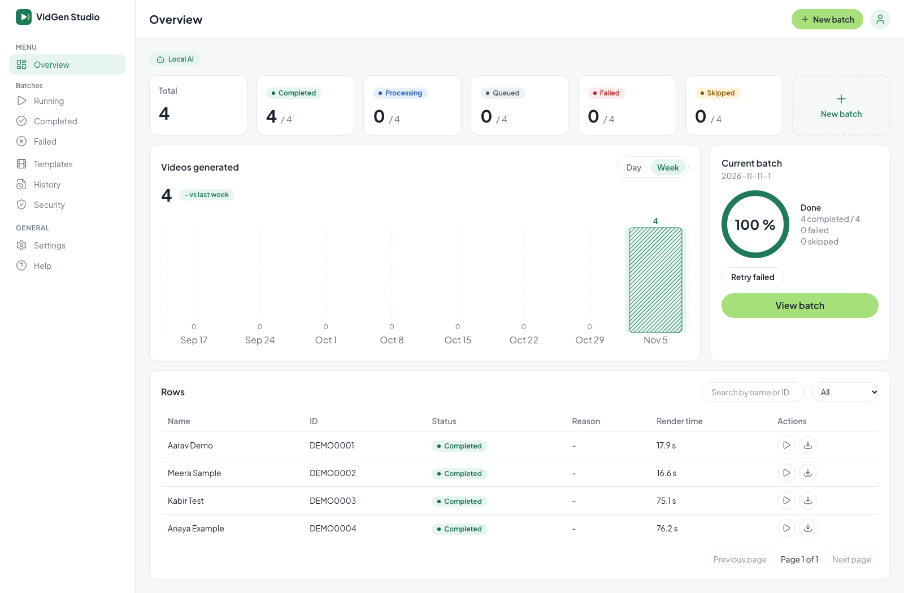
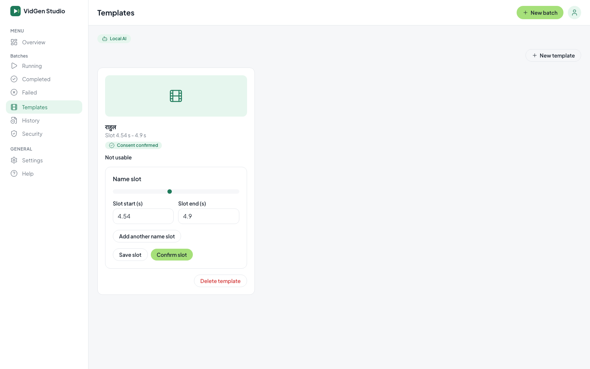
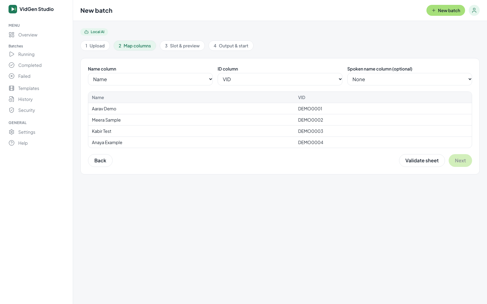
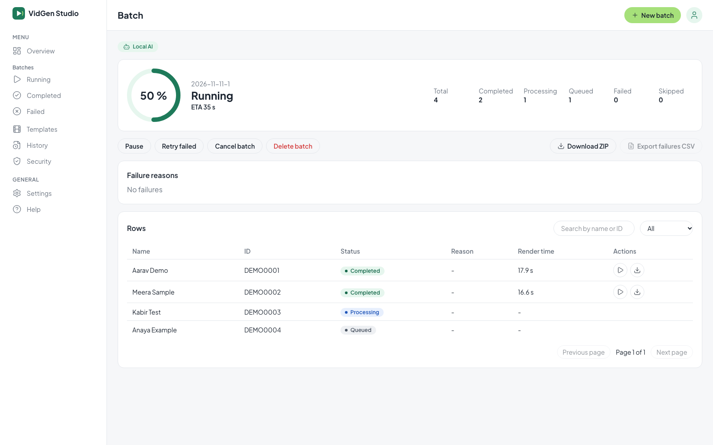
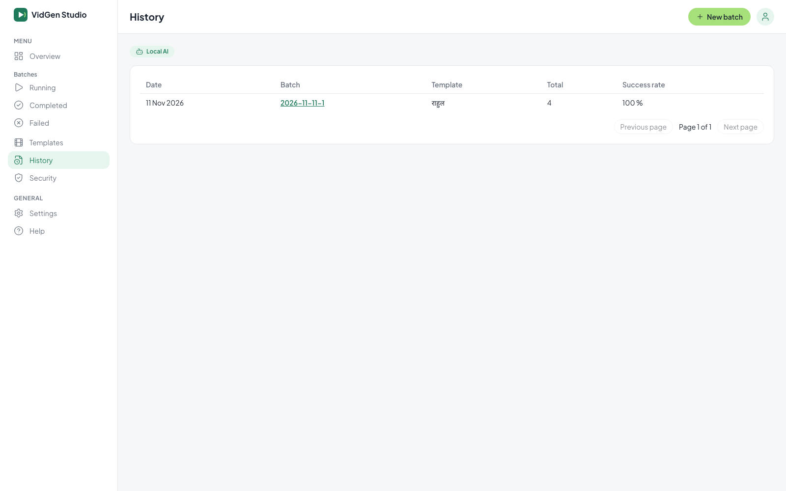
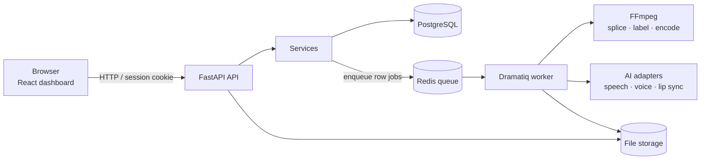

<div align="center">


# VidGen Studio

**One template video. Thousands of personalised videos.**

Upload a video and a sheet of names. VidGen Studio replaces the spoken name, re-syncs the lips, labels every clip as AI-generated and hands you a folder of ready-to-send MP4s.

[](https://github.com/singla25/video-generator/actions/workflows/ci.yml)


[Features](#features) · [Screenshots](#screenshots) · [How it works](#how-it-works) · [Performance](#performance) · [Install on macOS](#install-on-macos) · [Troubleshooting](#troubleshooting)

</div>

---

## Features

| | |
|---|---|
| **Batch personalisation** | Upload a template (MP4/MOV) and a `.xlsx`/`.csv` sheet. Only the name slot changes; the rest of the audio and video is untouched. |
| **Hindi and Latin names** | Devanagari support with transliteration and a per-row *spoken name* override. |
| **Safe by design** | Consent file required before a template can be used. Every frame carries an "AI-Generated / एआई-जनित" label and the file metadata records the creator and date. |
| **Preview gate** | Row 1 is rendered first; the batch starts only after you approve it. |
| **Reliable queue** | Each row is an independent job with one automatic retry. Pause, resume, cancel and retry-failed at any time. |
| **Clear results** | Live progress and ETA, failure breakdown by reason, batch history, per-video download, ZIP of all outputs and a failures CSV. |
| **Privacy** | Names and IDs are encrypted at rest, logs contain no personal data, batches can be deleted, and old data is removed automatically (default 30 days). |
| **Built to scale** | Large sheets (100,000 rows) and downloads are streamed, never loaded fully into memory. |

## Screenshots

Captured on 2026-11-11 from a running instance in local AI mode on a MacBook Pro (M4 Pro, 24 GB), using a separate demo database, a synthetic demo template and a sheet of made-up names. No real personal data is shown. The build shown includes the several-name-slots work (DD-40), which is not on `main` yet, so the template card shows an extra "Add another name slot" button.

**Overview**: KPI cards, videos per week, the current batch and its rows.



**Templates**: a template card with consent confirmed and the name slot found automatically, waiting for confirmation.



**New batch wizard**: step 2, mapping the sheet's Name and ID columns.



**A batch in progress**: progress, ETA, controls and per-row render times.



**History**: past batches with their success rate.



## How it works



1. **Upload** the template, consent file and sheet. Rows are validated; bad rows are skipped with a reason.
2. **Analyse** the template: the name is located with word timestamps, or you mark the slot by hand. The profile is reused by later batches.
3. **Preview** row 1 and approve it.
4. **Render**: the API only creates jobs; workers render in the background, so the web app stays responsive.
5. **Deliver**: `<ID>.mp4` files plus `manifest.csv` in the output folder.

AI models sit behind swappable interfaces. In the default **fake** mode no models run (fast, for development and tests). The **local** mode runs real models on Apple silicon (see [AI mode](#ai-mode)).

## Technology

| Layer | Technology |
|---|---|
| API | Python 3.11, FastAPI, Uvicorn, Pydantic Settings |
| Data | PostgreSQL 16, SQLAlchemy 2, Alembic |
| Queue | Redis 7, Dramatiq |
| Video / audio | FFmpeg and ffprobe, Pillow (label rendering) |
| Dashboard | React 19, TypeScript, Vite, Tailwind CSS 4, TanStack Query, Recharts |
| Security | Argon2 password hashing, encrypted personal data (`cryptography`), CSRF protection |
| Local AI (optional) | faster-whisper, Chatterbox TTS, MuseTalk, PyTorch |

## Performance

The numbers below must come from your own data. Run the read-only report on the machine that holds your PostgreSQL database; it prints **counts and timings only** (no names, IDs, file paths or credentials). Load your `.env` into the shell first, then:

```bash
.venv/bin/python scripts/bench_stats.py          # add --json for JSON
```

It reports: total videos and batches, success rate, average / median / P95 / min / max render time per video, and throughput (videos per hour, from completed batches' wall-clock time).

| Metric | Result |
|---|---|
| Videos rendered, batches | *not measured yet* |
| Success rate | *not measured yet* |
| Render time: average / median / P95 | *not measured yet* |
| Throughput (videos/hour) | *not measured yet* |

*Not filled in yet: `bench_stats.py` has to be run by the database owner, because the project's guard hook blocks automated tools from loading `.env`. Single row render times from the local AI demo batch are visible in the batch screenshot above, but four rows are not a benchmark.*

Documented design figures (from the project's plans, **not measurements of a production run**):

| Item | Figure | Source |
|---|---|---|
| Local AI mode peak memory | 16–18 GB RAM, one render at a time (the measured worker peak is higher, 20–21 GB: see [System requirements](#system-requirements)) | `docs/plans/m2-local-real-ai.md` |
| GPU throughput target | ≥ 100 videos/hour for a 30 s template | `docs/plans/m2-real-ai.md` (target) |
| Sheet validation target | 1,000 rows in < 3 s | `docs/plans/m1-batch-pipeline.md` (acceptance criterion) |

## System requirements

| | Fake mode (demo / development) | Local AI mode (pilot) |
|---|---|---|
| Mac | Apple silicon or Intel | Apple silicon only |
| Memory | Not benchmarked | **20–21 GB peak for the worker** (measured, see below); 32 GB recommended *(estimate)* |
| Disk | Space for videos and Docker volumes | Plus model weights (several GB, downloaded on first use) |
| Network | Needed for installs | Also for the first model download |

Intel Macs: PostgreSQL, Redis and the app use multi-architecture images and packages, so fake mode is expected to work, but it has not been tested on Intel here.

**Verified on (2026-11-11):** MacBook Pro (Mac16,8), Apple M4 Pro (12 cores: 8 performance + 4 efficiency), 24 GB RAM, macOS 27.0.1, with uv 0.13.1, Node.js 26.12.0, FFmpeg 9.0.2 and Docker Compose v5.6.0. The install steps below were run on this machine.

**Measured peak memory, local AI mode (same Mac, 2026-11-11).** These are the "Memory" column in Activity Monitor (`top -stats mem`), sampled every 2 s while the app rendered a 10.5 s, 1080x1300 demo template, one video at a time:

| Process / phase | Peak |
|---|---|
| Worker, first preview (models loading) | 21.0 GB |
| Worker, second preview | 20.0 GB |
| Worker, batch of 4 videos | 20.0 GB |
| API process, at the same time | 8.7 GB |
| Building the demo template (one MuseTalk lip sync, outside the app; `/usr/bin/time -l` peak footprint) | 13.9 GB |

**Does it fit in 24 GB?** It runs, and the 4-video demo batch completed, but only with heavy swapping: the system used about 17.8 GB of swap during the batch. The worker alone peaks above the 16–18 GB in the project's plans, and the worker and API together exceed 24 GB. That is why 32 GB is recommended, though that figure is an *estimate* and was not tested.

### Dependencies

| Dependency | Purpose | Version | Install manually? |
|---|---|---|---|
| Docker Desktop (Compose v2) | Runs PostgreSQL and Redis | recent | **Yes** |
| PostgreSQL | Database | 16 (container) | No, via Docker |
| Redis | Job queue | 7 (container) | No, via Docker |
| [uv](https://docs.astral.sh/uv/) | Python and package manager | recent | **Yes** |
| Python | Backend | 3.11 (`>=3.11,<3.12`) | No, uv installs it |
| Node.js + npm | Dashboard | 22 in CI; 26 verified on macOS | **Yes** |
| FFmpeg (includes ffprobe) | Video and audio processing | recent | **Yes** |
| Python packages | From `pyproject.toml` / `uv.lock` | locked | No, `uv sync` |
| npm packages | From `frontend/package-lock.json` | locked | No, `npm ci` |
| `local-ai` extra | Real AI models | pinned in `pyproject.toml` | No, installed by `dev_up.sh` in local mode |

No paid or external online service is required.

## Install on macOS

Works on Apple silicon and Intel. Commands assume [Homebrew](https://brew.sh).

**1. Install the tools**

```bash
xcode-select --install                 # command line tools (skip if already installed)
brew install uv node ffmpeg
brew install --cask docker             # then open Docker Desktop once and wait until it is running
```

CI uses Node.js 22, but Homebrew deprecated the `node@22` formula on 2026-10-30, and it is keg-only (not on your `PATH` by default). The guide was verified with the current `node` formula (26.12.0). If you need exactly Node 22, run `brew install node@22` and add `$(brew --prefix node@22)/bin` to your `PATH`.

**2. Get the code and dependencies**

```bash
git clone https://github.com/singla25/video-generator.git
cd video-generator
uv sync                                # installs Python 3.11 and backend packages
(cd frontend && npm ci)                # dashboard packages
```

**3. Start the database and queue**

```bash
docker compose up -d
docker compose ps                      # postgres and redis should be "healthy"
```

**4. Configure and create your admin login**

```bash
scripts/dev_up.sh                      # first run creates .env with random secrets, then asks for the admin step
.venv/bin/python scripts/dev_setup.py create-admin   # type a password (hidden; only its hash is saved)
```

`.env` is git-ignored and holds local secrets. Never commit or share it. `.env.example` lists the variables.

**5. Start the app**

```bash
scripts/dev_up.sh
```

The first start lists any database migrations that are not applied yet and asks `y/N`. Answer `y` to create the tables. With no answer, nothing is applied and nothing starts. Run it from an interactive terminal: if the input is piped or redirected, the script refuses to apply migrations.

**6. Verify**

```bash
curl http://127.0.0.1:8000/api/health  # API
```

Open **http://localhost:5173** and log in with your admin password.

**7. Stop**

```bash
scripts/dev_down.sh                    # stops API, worker and dashboard
docker compose down                    # optional: stops PostgreSQL and Redis (data is kept in Docker volumes)
```

### AI mode

By default the app runs with **fake** AI adapters (no models, no cost). To try the real models on an Apple-silicon Mac, set `VIDGEN_AI_MODE=local` in `.env` (or the shell) and run `scripts/dev_up.sh`. This installs the `local-ai` extra, downloads weights on first use into `backend/spikes/m2_mac/work/local_ai_weights` (override with `VIDGEN_LOCAL_AI_WEIGHTS_DIR`) and renders one video at a time. This is a pilot; details in [docs/plans/m2-local-real-ai.md](docs/plans/m2-local-real-ai.md).

## Usage

1. **Log in** at http://localhost:5173.
2. **Templates:** upload your template video and the consent file, tick the confirmation, and confirm the name slot.
3. **New batch:** upload the sheet, map the Name, ID and optional Spoken-name columns, and review skipped rows.
4. **Preview:** check the rendered preview of row 1 and approve it to start.
5. **Monitor:** the Overview and batch pages show progress, ETA and failures. Pause, resume, cancel or retry failed rows.
6. **Download:** single videos, a ZIP of all outputs, or the failures CSV. **History** lists past batches.

## Troubleshooting

<details>
<summary><b>"Postgres or redis is not reachable"</b></summary>

Docker Desktop is not running or the containers are down. Open Docker Desktop, then `docker compose up -d` and check `docker compose ps`.
</details>

<details>
<summary><b>Port already in use (8000, 5173, 5432, 6379)</b></summary>

Find the process with `lsof -i :5432`. The API (8000) and dashboard (5173) ports are fixed. For PostgreSQL and Redis set `VIDGEN_DB_PORT` / `VIDGEN_REDIS_PORT` before `docker compose up -d` and update the URLs in `.env`.
</details>

<details>
<summary><b>"Run 'uv sync' first" or "Run 'cd frontend && npm ci' first"</b></summary>

Install the packages as in step 2, then run `scripts/dev_up.sh` again.
</details>

<details>
<summary><b>Nothing starts after the migration question</b></summary>

Run the script from an interactive terminal and answer `y`. Without a terminal it never applies migrations.
</details>

<details>
<summary><b>Something fails after start</b></summary>

Read the logs in `.dev/logs/` (`api.log`, `worker.log`, `web.log`, `migrate.log`).
</details>

<details>
<summary><b>Devanagari text in the AI label looks wrong</b></summary>

The fonts ship with the app. Correct Devanagari needs complex text shaping (Pillow's RAQM layout, which uses FriBiDi). Without it, vowel signs land in the wrong place (for example जनति instead of जनित).

Check: `.venv/bin/python -c "from PIL import features; print(features.check('raqm'), features.check('fribidi'))"` should print `True True`. If it doesn't, run `brew install fribidi` and restart the app.

*Verified on 2026-11-11 (Apple M4 Pro, macOS 27.0.1): with Homebrew `fribidi` 1.0.17 installed, both checks are `True` and the label renders correctly. The case without `fribidi` was not tested, because it was already installed on that Mac. On Linux, CI installs `libraqm0` and `libfribidi0`.*
</details>

## Development

```bash
uv run pytest -q                              # backend tests
uv run ruff check backend tests               # lint
uv run mypy --strict backend/vidgen           # types
(cd frontend && npm test)                     # dashboard tests
```

CI runs the same checks on every pull request.

## Project structure

```
backend/vidgen/   api/ · services/ · domain/ · ports/ · infrastructure/ · worker/
backend/migrations/   Alembic migrations (PostgreSQL)
frontend/         React dashboard (Vite, TypeScript, Tailwind)
scripts/          dev_up.sh · dev_down.sh · dev_setup.py · bench_stats.py
tests/            unit · integration · e2e
docs/             plans · decisions (ADRs) · requirements · development-workflow.md
docker-compose.yml   PostgreSQL 16 + Redis 7 for local use
```

More detail: [architecture decisions](docs/decisions/), [requirements](docs/requirements/REQ-001-personalized-video-batch.md), [contributor workflow](docs/development-workflow.md).

## License and support

No license file is included in this repository yet, so all rights are reserved by default. Contact the owner before reuse.

Questions and bug reports: [GitHub Issues](https://github.com/singla25/video-generator/issues).
